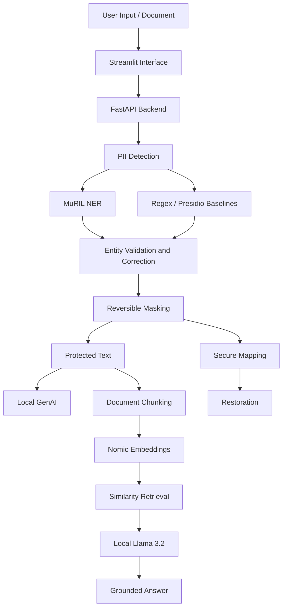

# IndiaPII — Indian Multilingual PII Detection and Reversible Masking

**A privacy-aware document intelligence platform for detecting, protecting and working with Personally Identifiable Information (PII) in Indian multilingual text.**

IndiaPII combines multilingual Named Entity Recognition (NER), rule-based detection, reversible masking and locally hosted Generative AI with Retrieval-Augmented Generation (RAG).

The system supports English, Hindi and Hinglish while preserving useful document information such as financial amounts and dates.

## Key Features

- **Multilingual PII Detection:** Fine-tuned MuRIL model for identifying sensitive entities in English, Hindi and Hinglish.
- **Baseline Comparison:** Regex and Microsoft Presidio-based detection for performance comparison.
- **Indian PII Handling:** Detection and validation logic for Aadhaar, PAN, Indian phone numbers, email addresses, UPI IDs, names and addresses.
- **Reversible Masking:** Replaces sensitive information with typed placeholders and maintains a mapping for restoration.
- **Local GenAI:** Uses Ollama and Llama 3.2 for summarisation, question answering and rewriting.
- **Document Intelligence:** Uses local embeddings and vector similarity retrieval to answer questions about protected documents.
- **Interactive Interface:** Streamlit application with five workspaces.
- **REST API:** FastAPI backend exposing detection, masking, restoration and AI endpoints.

## Technology Stack

| Component | Technology |
|---|---|
| Programming language | Python 3.11 |
| Multilingual NER | Google MuRIL |
| Baselines | Regex, Microsoft Presidio |
| Deep learning | PyTorch, Hugging Face Transformers |
| Backend | FastAPI |
| Frontend | Streamlit |
| Local LLM | Ollama, Llama 3.2 |
| Embeddings | Nomic Embed Text |
| Retrieval | Cosine similarity |
| Evaluation | Precision, Recall, F1-score |

## Repositories and Model

- **GitHub source code:** https://github.com/navyaa09/IndiaPII
- **Fine-tuned MuRIL model:** https://huggingface.co/navya0909/indiapii-muril

The fine-tuned MuRIL model is hosted separately on Hugging Face because of its size. Model weights are not included in the GitHub repository.

## System Architecture



## PII Categories

The project supports seven entity categories:

- PERSON
- ADDRESS
- PHONE
- AADHAAR
- PAN
- EMAIL
- UPI

The detector also applies validation and contextual corrections to reduce incorrect masking of dates and Indian financial amounts.

## Application Workspaces

| Workspace | Function |
|---|---|
| Detect | Identifies PII entities and displays detection results |
| Mask | Replaces detected PII with typed placeholders |
| Restore | Reconstructs original text using the reversible mapping |
| GenAI Assistant | Summarises, answers questions and rewrites protected text |
| Document Intelligence | Indexes protected documents and answers questions using RAG |

## RAG Workflow

1. The user uploads or enters a document.
2. The document passes through PII detection and masking.
3. Only masked document content is sent to the RAG indexing component.
4. The document is divided into text chunks.
5. Nomic Embed Text generates local embeddings.
6. Question embeddings are compared with document embeddings.
7. Relevant chunks are retrieved.
8. Llama 3.2 generates an answer using the retrieved protected context.

The current RAG index is held in FastAPI process memory and is cleared when the server restarts. Persistent indexing is a planned improvement.

## Model Evaluation

The project compares three PII detection approaches:

- Regex-based detection
- Microsoft Presidio
- Fine-tuned MuRIL

Evaluation includes entity-level precision, recall and F1-score, along with language-wise performance.

The current experiments use a synthetic multilingual dataset. Reported performance should therefore be interpreted in the context of the dataset size and distribution, rather than as a guarantee of real-world accuracy.

## Project Structure

```text
IndiaPII/
├── app/
│   └── streamlit_app.py
├── src/
│   ├── api.py
│   ├── detector.py
│   ├── masker.py
│   └── rag.py
├── models/
│   └── muril-pii/
├── data/
│   ├── raw/
│   └── processed/
├── notebooks/
├── results/
│   └── comparison/
├── test_masking.py
├── requirements.txt
├── .gitignore
└── README.md
```

**Note:** Model weights and sensitive datasets are not committed to GitHub.

## Installation and Setup

### Prerequisites

- Python 3.11
- Git
- Ollama
- Sufficient disk space and RAM for the MuRIL model and local LLM.

### 1. Clone the repository

```bash
git clone https://github.com/navyaa09/IndiaPII.git
cd IndiaPII
```

### 2. Create a virtual environment

**macOS / Linux:**

```bash
python3.11 -m venv .venv
source .venv/bin/activate
```

**Windows PowerShell:**

```powershell
py -3.11 -m venv .venv
.venv\Scripts\Activate.ps1
```

### 3. Install dependencies

```bash
python -m pip install --upgrade pip
pip install -r requirements.txt
pip install -U huggingface_hub
```

### 4. Download the fine-tuned MuRIL model

The fine-tuned model is publicly hosted on Hugging Face.

Download it directly into the expected local model directory:

```bash
hf download navya0909/indiapii-muril --local-dir models/muril-pii
```

After downloading, verify that the directory contains:

```text
models/muril-pii/
├── config.json
├── model.safetensors
├── tokenizer.json
├── tokenizer_config.json
└── training_args.bin
```

No Hugging Face access token is required while the model repository remains public.

### 5. Install and configure Ollama

Download Ollama from:

https://ollama.com/download

Install and start Ollama.

Pull the required local models:

```bash
ollama pull llama3.2:3b
ollama pull nomic-embed-text:latest
```

Ensure the Ollama service is running before testing the GenAI and RAG workspaces.

### 6. Start the FastAPI backend

From the project root:

```bash
uvicorn src.api:app --reload
```

The backend runs at:

```text
http://127.0.0.1:8000
```

API documentation:

http://127.0.0.1:8000/docs

### 7. Start the Streamlit application

Open a separate terminal, navigate to the project directory and activate the virtual environment.

Run:

```bash
streamlit run app/streamlit_app.py --server.port 8501
```

Open:

http://localhost:8501

**Important:** Keep both the FastAPI backend and Ollama running while using the complete application.

## API Endpoints

| Method | Endpoint | Purpose |
|---|---|---|
| GET | `/health` | Backend health |
| POST | `/detect` | Detect PII |
| POST | `/mask` | Mask PII |
| POST | `/unmask` | Restore original text |
| GET | `/genai/health` | Check local GenAI availability |
| POST | `/genai` | GenAI tasks |
| POST | `/rag/index` | Index masked document |
| POST | `/rag/ask` | Ask document questions |
| POST | `/rag/delete` | Delete indexed document |

## Privacy Considerations and Limitations

- Original PII should not be sent to the local LLM or embedding model.
- Reversible mappings are sensitive and should be protected.
- The current RAG index is in-memory and does not persist across FastAPI restarts.
- Local execution does not by itself guarantee complete security.
- MuRIL predictions and heuristic corrections may produce false positives and false negatives.
- Synthetic-data evaluation does not establish performance on all real-world Indian documents.

## Future Improvements

- Persistent and scalable vector storage.
- Improved multilingual retrieval and reranking.
- Expanded real-world and domain-specific evaluation.
- Stronger mapping encryption and access controls.
- Document lifecycle management and audit logging.
- Deployment and performance optimisation.

## Project Status

**Research prototype — core detection, reversible masking, local GenAI and RAG workflows implemented.**

Further validation, persistent storage, security hardening and deployment remain areas for improvement.
